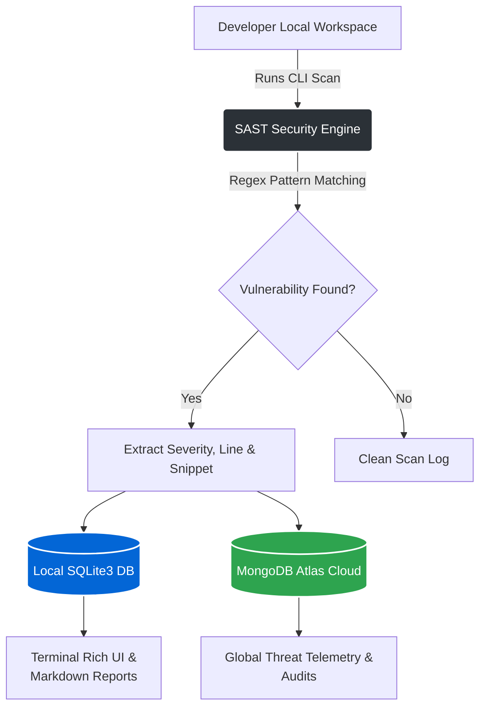
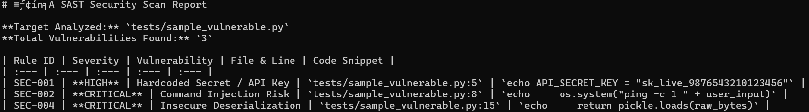
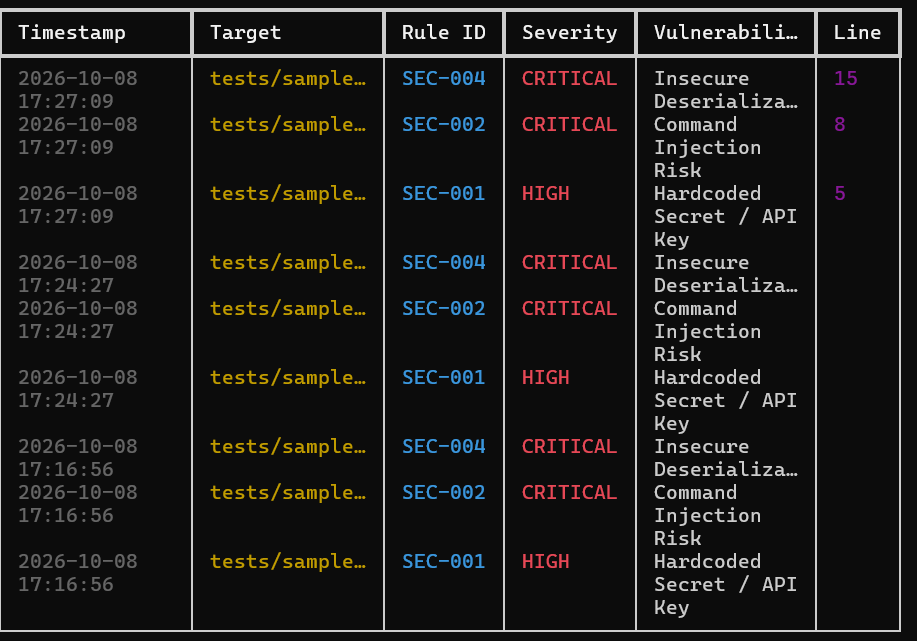
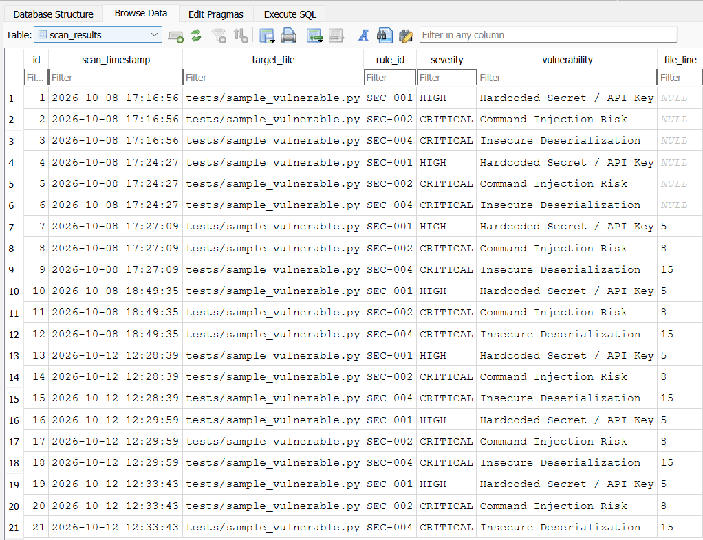
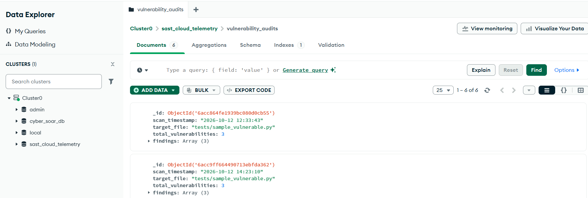

# 🔍SAST Security Analyzer: Edge-Optimized Static Code Assessment Engine

[](https://www.python.org/)
[](https://www.mongodb.com/)
[](https://docs.pytest.org/)
[](LICENSE)

A modular, terminal-based **Static Application Security Testing (SAST)** engine engineered in Python. Designed as the **Phase 1 Code-Level Detection Engine** of an end-to-end DevSecOps framework, it performs regex-based vulnerability pattern matching, maintains local edge audit trails, and synchronizes global security telemetry to cloud storage.

---

## 🏗️ Architecture & Data-Flow Mind Map
The pipeline executes a local static code scan to parse vulnerability vectors through custom regex rules. Detected findings are simultaneously committed to a local SQLite database for instant developer feedback and asynchronously synchronized to MongoDB Atlas for centralized cloud threat telemetry.

## 🔑 Core Technical Features

| Feature | Technical Implementation | Value & Capabilities |
| :--- | :--- | :--- |
| **Regex Pattern Matching Engine** | Custom Python Engine | Scans source repositories for Hardcoded Secrets, Command Injection, SQL Injection, and Insecure Deserialization. |
| **Dual-Storage Telemetry** | `SQLite3` & MongoDB Atlas | Stores local scan logs in `SQLite3` for fast developer feedback while syncing threats asynchronously to MongoDB. |
| **Terminal UI Dashboard** | `click` & `rich` | Renders styled CLI table views, status indicators, and interactive scan progress. |
| **Automated Compliance** | Markdown Generator | Automatically exports structured compliance audit logs and scan reports under `reports/`. |
| **Automated Test Suite** | `pytest` | Validates vulnerability detection rules and database persistence workflows. |

---

```text
├── assets/
│   ├── cil_output.png
│   ├── compliance_report.png
│   ├── mongodb_audit_telemetry.png
│   ├── pytest_validation.png
│   ├── sast_scan_history.png
│   └── sqlite_scan_results.png
├── scanner/
│   ├── __init__.py
│   ├── cli.py
│   ├── database.py
│   ├── engine.py
│   └── rules.json
├── tests/
│   ├── sample_vulnerable.py
│   └── test_engine.py
├── .env.example
├── .gitignore
├── Dockerfile
├── LICENSE
├── README.md
├── requirements.txt
└── sast_results.db
```
## ⚙️Installation & Setup

```bash
git clone [https://github.com/rajeshgurindapalli15-crypto/sast-security-analyzer.git](https://github.com/rajeshgurindapalli15-crypto/sast-security-analyzer.git)
cd sast-security-analyzer
python -m venv venv
venv\Scripts\activate  
pip install -r requirements.txt
```

## 🧪Test Harness Execution & Engine Verification

To maintain code reliability and validate matching criteria across regex rule sets, an automated test suite is integrated. Below is the console output confirming successful test execution via `pytest`:


## 💻Diagnostic CLI Execution & Data Presentation

To execute a static code analysis and render intercepted vulnerability vectors in real time, the scanning utility is invoked via the terminal. Below is the active CLI execution and structured table representation rendered via `rich`:


## 📄Automated Compliance Report Artifact

Upon completing the analysis, the engine automatically compiles and exports a standardized security audit document. Below is the raw content structure of the generated report stored within the `reports/` directory:




## 📊Historical Scan Logging & Audit Trail

To maintain a chronological history of security assessments, the analyzer logs each scan event with exact timestamps, targeted files, triggered rule IDs, and specific vulnerability line numbers. Below is a structured view of the audit trail captured during test runs:



### 💾Local Persistence (SQLite)
Stores structured scan results locally with timestamps, rule IDs, and vulnerability severity levels. Enables fast, offline retrieval of historical scan data directly from the `sast_results.db` relational database.



### ☁️Cloud Audit Telemetry (MongoDB Atlas)
Automatically streams append-only audit logs and comprehensive finding arrays to a centralized cloud cluster. Provides immutable, chronological telemetry tracking across multiple scan executions for enterprise observability.



## 📜 License

This project is licensed under the **MIT License** — see the [LICENSE](LICENSE) file for details.
