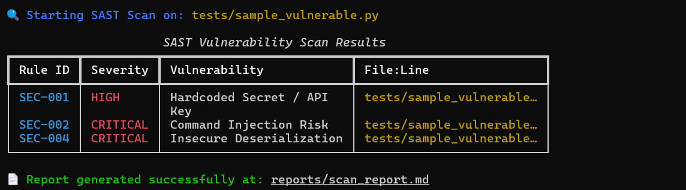
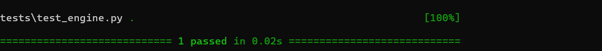

# SAST Security Analyzer: Edge-Optimized Static Code Assessment Engine

[](https://www.python.org/)
[](https://www.mongodb.com/)
[](https://docs.pytest.org/)
[](https://opensource.org/licenses/MIT)

A modular, terminal-based **Static Application Security Testing (SAST)** engine engineered in Python. Designed as the **Phase 1 Code-Level Detection Engine** of an end-to-end DevSecOps framework, it performs regex-based vulnerability pattern matching, maintains local edge audit trails, and synchronizes global security telemetry to cloud storage.

---

## 🏗️ Architectural Role in the Secure SDLC

This project operates as **Phase 1 (Code-Level Detection)** in a three-tier DevSecOps framework:

| SDLC Phase | Component | Storage & Action |
| :--- | :--- | :--- |
| **Phase 1 (Edge)** | **SAST Security Analyzer** | Scans local code, logs findings locally via **SQLite3**, and syncs telemetry to **MongoDB Atlas**. |
| **Phase 2 (CI/CD)** | Compliance Pipeline | Enforces automated policy gates prior to build approval. |
| **Phase 3 (Runtime)** | SOAR Pipeline | Manages live threat ingestion and automated incident response. |SDLC

## Core Technical Features

* **Regex Pattern Matching Engine**: Scans source code repositories for high-severity vulnerability vectors, including Hardcoded Secrets, Command Injection, SQL Injection, and Insecure Deserialization.
* **Dual-Storage Telemetry Persistence**: 
  * *Local Edge Layer (SQLite3):* Fast, zero-configuration local caching for immediate developer feedback and offline audit logging.
  * *Cloud Telemetry Layer (MongoDB Atlas):* Asynchronous threat synchronization for centralized historical analysis.
* **Terminal UI Dashboard**: Styled CLI table outputs built using `click` and `rich`.
* **Automated Compliance Reporting**: Generates standardized Markdown security audits under `reports/`.
* **Rigorously Tested**: End-to-end test suites powered by `pytest`.

---

## Installation & Setup

```bash
git clone [https://github.com/rajeshgurindapalli15-crypto/sast-security-analyzer.git](https://github.com/rajeshgurindapalli15-crypto/sast-security-analyzer.git)
cd sast-security-analyzer
python -m venv venv
venv\Scripts\activate  # On Unix/macOS: source venv/bin/activate
pip install -r requirements.txt
```
## Diagnostic CLI Execution & Data Presentation

To execute a static code analysis and render intercepted vulnerability vectors in real time, the scanning utility is invoked via the terminal. Below is the active CLI execution and structured table representation rendered via `rich`:



## Automated Compliance Report Artifact

Upon completing the analysis, the engine automatically compiles and exports a standardized security audit document. Below is the raw content structure of the generated report stored within the `reports/` directory:


## Test Harness Execution & Engine Verification

To maintain code reliability and validate matching criteria across regex rule sets, an automated test suite is integrated. Below is the console output confirming successful test execution via `pytest`:



## Historical Scan Logging & Audit Trail

To maintain a chronological history of security assessments, the analyzer logs each scan event with exact timestamps, targeted files, triggered rule IDs, and specific vulnerability line numbers. Below is a structured view of the audit trail captured during test runs:


